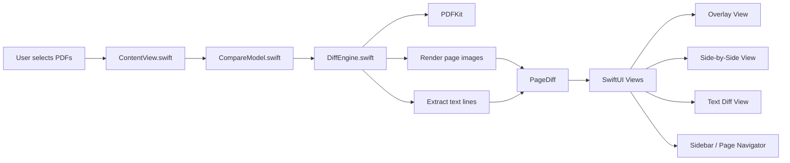

# Architecture

This project is intentionally small and easy to reason about. The app flow is straightforward: the user selects PDFs, the model kicks off a compare pass, and the diff engine renders visual and text differences for the UI to display.

## Component roles

- `ContentView.swift`: main macOS interface, file slots, navigation controls, and mode switching
- `CompareModel.swift`: app state, selection, progress tracking, and orchestration of compare jobs
- `DiffEngine.swift`: PDF loading, page rendering, pixel diffing, and text comparison
- `PDFKit`: native PDF parsing and page access on macOS
- `PageDiff`: normalized result object used by the UI to render differences and summaries

## High-level flow

1. The user drops or selects two PDFs in the main window.
2. `CompareModel` triggers `DiffEngine.compare(...)`.
3. Each page is rendered and compared visually and textually.
4. Changed pages are summarized as `PageDiff` entries.
5. The SwiftUI interface shows overlay, side-by-side, or text-diff detail based on the current mode.
